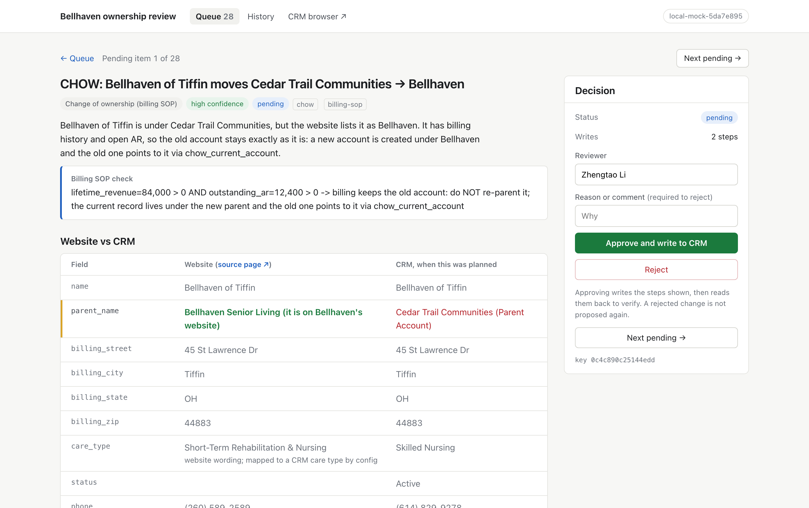

# Bellhaven ownership sync

Keeps the CRM's *facility → parent company* links accurate for one operator (Bellhaven Senior Living).
Every day it reads the operator's website, matches each community to CRM accounts, and queues the changes it
thinks are needed. A reviewer approves or rejects each change in a small local app. Only approved changes are
written to the CRM, through its API.



**At a glance**
- Scraper finds all 35 communities, including one that only appears on the homepage.
- Matching is address-first, so renamed facilities are found and same-name decoys in other states are not.
- Every parent move goes through the billing SOP: revenue + open AR means a CHOW (new account + link), never a re-parent.
- Nothing is written without approval; every write is re-checked first and read back after.
- Re-runs are safe: decided changes are never proposed again. 80 offline tests.

```
website ──scrape──► 35 locations ──┐
                                   ├─► match + classify (+ billing SOP) ─► proposals ─► review app ─► approve ─► CRM API
CRM API ──read all pages──► 121 accounts ──┘                                (SQLite)              reject  ─► remembered
```

## Run it

```bash
uv sync
cp .env.example .env                          # CRM / website URLs + CRM_TOKEN
export PYTHONPATH=src                         # see note below
uv run python -m bellhaven_sync.cli run       # scrape + match + queue proposals. Never writes to the CRM
uv run python -m bellhaven_sync.cli review    # review app on http://127.0.0.1:8300
uv run python -m bellhaven_sync.cli status    # queue counts + last run
uv run pytest -q                              # 80 tests, fully offline
```

**Offline demo.** `devtools/` holds two local stand-ins, and `.env.example` points at both.
Start them before `run` / `review`:

```bash
uv run python -m devtools.mock_crm --reset --port 8100 &   # CRM API + browser at http://127.0.0.1:8100/crm/accounts
uv run python -m devtools.site_mirror --port 8200 &        # the website
```

- `mock_crm.py` (port 8100): a local copy of the CRM API, seeded with the sandbox's initial state, with a read-only
  CRM browser at `/crm/accounts`.
- `site_mirror.py` (port 8200): a saved copy of the website.

Two guards keep demo data and real data apart:
- The client refuses non-local hosts unless `ALLOW_REMOTE=1`.
- Review state is kept per CRM workspace (endpoint + token), so practice decisions never suppress real ones.

**Real sandbox.** Set `WEBSITE_BASE_URL`, `CRM_BASE_URL`, `CRM_BROWSER_URL`, `CRM_TOKEN` and `ALLOW_REMOTE=1` in `.env`.

> `PYTHONPATH=src`: on some macOS setups the editable-install `.pth` file is flagged hidden and Python skips it.
> pytest sets the path itself.

**Daily schedule.** `deploy/crontab.txt` runs `deploy/daily_run.sh` once a day.
- The run only proposes; it never writes to the CRM.
- It uses the checkout's virtualenv by absolute path, so it works with cron's minimal PATH.
- If a run fails, a line is appended to `logs/ALERTS.log`.

## How it works

### 1. Scrape (`website.py`)
- Follows the directory's "Next" links to the last page.
- Also scans the homepage and the About page for community links. Findlay is announced on the homepage but missing
  from the directory.
- Each detail page gives name, street, city, state, zip and care offerings. Care offerings are a list: Erie and
  Findlay each have two.
- Phone and administrator are kept only as evidence.

**Trusting the crawl**
- *Quarantine:* a page missing a required field (for example no zip) gets no proposal and a warning in the app.
- *Absence checks:* a run concludes "no longer on the website" only when the crawl is complete. A failed page or
  source, unfinished pagination, or counts that disagree with the site's own "35 / 34 listed" each turn absence
  checks off. The queue page explains why.

### 2. Match (`match.py`)
The street address is a facility's identity: names change with every acquisition, the address stays.

- **Address rule.** Same state and same house number. The street must also have the same type and direction after
  normalization (Rd/Road, Pk/Pike, NW/Northwest), so Cleveland **Rd** never matches Cleveland **Dr**. On top of that,
  the street name must be near-identical, and the zip or the city must agree.
- **Fallback** for a CRM street that can't be compared (PO Box, blank, or a mistyped house number). The same state
  and city plus a strongly similar name are required, *and* the zip or the phone must corroborate it. This is
  always medium confidence. It is how the PO-Box Ashtabula record is found.
- **A name alone never matches.** This excludes the Colorado "Amberly Manor", New Carlisle OH vs Carlisle PA, and
  Union Square Senior Living at another street.
- **Conflicts.** One CRM record that matches two website locations becomes a CONFLICT for a person to resolve.
  There is no guessing.

### 3. Classify (`plan.py`) — one proposal per logical change
| Situation | Proposal |
|---|---|
| Matched, wrong / missing parent | **REPARENT** |
| ...and it has `lifetime_revenue > 0` **and** `outstanding_ar > 0` | **CHOW**: old account untouched; new account under Bellhaven; old `chow_current_account` → new |
| Several records at one address, none under Bellhaven | **CONSOLIDATE**: move the survivor and retire the copies in one decision |
| Several records, one already under Bellhaven | **DUPLICATE** per copy (`duplicate_of_account` + Inactive). A billing-locked copy under another parent gets a **CHOW** link instead |
| Outdated name / formatting-only name | **RENAME** to the exact website name (formatting-only ones are labelled) |
| Street / city / zip differ | **ADDRESS** (a billing PO Box is kept) |
| Listed on the website but Inactive / Needs Review | **REACTIVATE** |
| No CRM record | **CREATE** under Bellhaven |
| Under Bellhaven, not on the website | CHOW link / DUPLICATE if another operator's record holds the address; otherwise **NOT_ON_SITE** → Needs Review + note |

**Survivor rule.** The first rule that separates two records decides, and the review screen names it:
1. Already under Bellhaven.
2. Not Inactive (a record a person flagged Needs Review still counts as live).
3. Has billing history.
4. The website phone or administrator corroborates it.
5. Under a documented predecessor (Harborview, Cedar Trail).
6. Exact normalized address.
7. Address typed exactly as on the site.
8. Lowest id.

### 4. Review and write (`review/app.py`, `executor.py`)
**What each item shows**
- The exact writes, as field: current → proposed.
- The website and CRM records side by side.
- The match signals, the billing-SOP verdict, the duplicate group, and contacts.

**Approving and rejecting**
- *Reject* requires a reason and writes nothing.
- *Approve* claims the proposal in the same transaction, `pending → applying`. The claim only succeeds if the reviewer
  saw the current version. Double clicks, a second tab, or a refreshed proposal are refused.
- A file lock ensures a pipeline run and a CRM write never overlap.

**Checks before writing.** Before writing anything, the executor re-checks the live CRM:
- the values the reviewer saw;
- the fields the decision depended on;
- the record it points at;
- for a create, that no live account already represents the facility.

If anything moved, nothing is written and the next run re-plans. For example, a direct move becomes a CHOW once AR
appears.

**Progress comes from the CRM, not from our log.**
- A PATCH counts as done when the record already holds the desired values.
- A create counts as done when the account it made can be found again: by the id logged when the POST
  returned, or by the marker `[bhsync <key>#<op>]` written into its note. That account is then verified. A wrong
  field is corrected, but only after every check has passed. It is never re-parented if it has since gained
  billing history, and never used if someone has linked it elsewhere.
- A create is only sent if no live account already represents the facility, using the planner's own matching rules.
  This includes phone corroboration, and records known at planning time stop being exempt once they have become
  the successor.
- POST is never retried automatically. A POST that never left the machine (connection refused) is simply retried.
  If a create was sent but can't be found again, the retry stops. A person then checks the CRM and either confirms it
  wasn't created, or closes the proposal so the next run re-plans from what is actually there.
- If part of a change landed and then the records moved, the proposal stays `failed` and locked for a person to
  check.

**Verification.** Every write is read back with a normalizer, so `""` vs `null`, `47000` vs `"47000.00"` and ZIP+4 are
treated as equal. Every write is logged on the History page.

### 5. Re-runs
- A proposal's key hashes the subject, the current values and the desired values.
- An approved or rejected key is never queued again.
- A new situation is a new key and is reviewed again: the website renames again, or someone edits the record.
- An applied change that the CRM later loses is re-queued and marked *regressed*.

## Result on the sandbox data (35 locations, 121 accounts → 127)

The real sandbox run produced 28 proposals. I approved 27 and rejected one: the formatting-only rename of
Ashland ("Health Care Center" vs "Healthcare Centre"), since the match and parent were already right. The final
CRM matches the expected end state below, and a re-run proposes nothing.


| Proposal | n | |
|---|---|---|
| CHOW | 3 | Marietta, Tiffin (Cedar Trail → Bellhaven; both have revenue + AR) · Sandusky (left Bellhaven for Millstone: old account left as is and linked to the existing Millstone account) |
| REPARENT | 3 | Lima (revenue, no AR), Findlay (no parent), Zanesville |
| CONSOLIDATE | 1 | Kettering: 3 copies (Harborview / none / Cedar Trail) → keep the Harborview one, move it, retire 2 |
| RENAME | 9 | rebrands: Chagrin Falls, Chesterton, Willow Creek, Zanesville, Kettering · formatting only: Sycamore Ridge, Ashland, Grove City, Dayton |
| ADDRESS | 1 | Portsmouth zip 45626 → 45662 (one proposal per field) |
| CREATE | 4 | Batavia, Carlisle PA, Amberly Manor (Hudson OH), Bellhaven at Union Square |
| DUPLICATE | 5 | Monroe ×2, Owosso, Port Clinton, Erie |
| NOT_ON_SITE | 2 | Alliance, Coldwater → Needs Review |

After everything is approved, each website location resolves to exactly one Active, non-duplicate account under
Bellhaven (35). Decoys and unrelated records are untouched. A re-run proposes nothing (`tests/test_end_to_end.py`).

## Limits of the API (disclosed, not solvable client-side)
- **No conditional writes / ETags.** Another CRM user can change a record between the executor's re-check and its
  PATCH. The window is milliseconds and every write is read back, but it can't be closed from the client.
- **No multi-record transaction.** A CHOW or consolidation can be left half-applied by a failure. It stays `failed`
  and locked, shows on the review page, and a retry finishes it.
- **No idempotency key, no delete.** A create whose outcome is unknown and can't be found again needs a person to
  reconcile it. A mistaken account can only be retired (link + Inactive), never removed.

## Judgment calls (and the alternative)
- **Sandusky.** It is off the website, and a Millstone account already sits at its address, so it changed hands.
  The old account has revenue and AR, so it is left exactly as it is and its `chow_current_account` points to the
  Millstone account that already exists at the address. The SOP's "create a new account under the correct parent"
  is already satisfied by that record; creating a second one would add a duplicate for the same facility.
  - *Alternative:* the literal reading: create a new Millstone account, link the old one to it, and retire the
    pre-existing Millstone copy as its duplicate.
  - It's one config line (`sop.existing_successor: create`) and is covered by a test.
- **Ashtabula.** The CRM billing street is "PO Box 517", a valid billing address, so it is kept. Name, city, zip and
  phone tie the record to the website location.
- **Alliance / Coldwater.** Absence from the website isn't proof of a sale or a closure, so these get **Needs Review**
  with a note rather than Inactive.
- **Duplicates.** Losing copies keep their parent link and get `duplicate_of_account` + Inactive plus a note.
  Contacts are not moved; for example, the Owosso copy keeps its Admissions Director.
- **Phones.** 24 of 35 website area codes differ from the facility's state, so phones are never written. They are
  used only as corroborating evidence.

## Layout
```
src/bellhaven_sync/  config, website (scraper), crm (API client), normalize, match, plan (classify + SOP),
                     state (SQLite), executor (the only writer), pipeline, cli, review/ (FastAPI + Jinja)
devtools/            mock_crm.py, site_mirror.py, seed/ (initial CRM), site/ (saved website)
deploy/              crontab.txt, daily_run.sh
tests/               end-to-end expected state, regression tests for edge cases, unit tests
docs/                CASES.md (expected outcome per location), review-app.png
```
